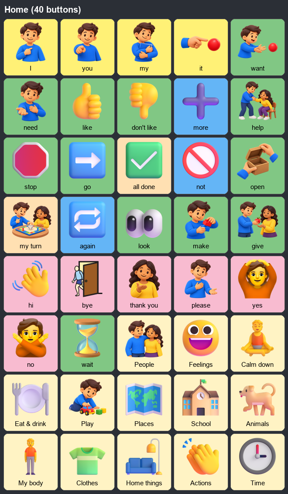

# Simpler Home, voice choice and duplicate cleanup (pack v7)

## Duplicates removed

- Home had 71 buttons. Nine category buttons appeared twice, Speak and Clear
  repeated the toolbar, and 23 more categories filled the page. Home now has
  40 buttons: 24 core words, **yes / no / wait** and 13 categories.
- Smaller categories open from their parent category:
  - Eat & drink: Snacks, Kitchen, Fruits, Vegetables
  - Play: Toys, Sports, Music
  - Animals: Wild animals, Sea animals, Birds, Bugs
  - Places: Buildings, Vehicles, Weather, Plants
  - School: School things, Colors, Alphabet, Numbers
  - People: Jobs
  - My body: Health
- "Fruits & veggies" only copied Fruits and Vegetables, so it was deleted. The
  following duplicate buttons were also removed: "fire truck 2", "cherry" (same
  as "cherries"), "blossom" (same as "flower"), "drum toy", "music play" (replaced
  by the Music link) and "fruit" (next to the Fruits category, with the same picture).
- "hi" and "bye" had the same waving hand. "bye" now shows a person leaving through a door. Sports,
  Vehicles, Birds and Wild animals now have category pictures that differ from
  the words beside them.
- Calm down adds **break**, **too loud** and **Sensory games**.
- Word colours follow the Fitzgerald key. Action words (clap, sleep, brush teeth …) are now green verbs. Colours, hot and cold are now blue describing words.
- A test checks that no page repeats a word or a picture. It also checks that every category opens from Home.

Installed apps upgrade automatically and keep a backup. Buttons that the user edited or starred are never removed.
New words go next to the core words, and custom buttons and layouts remain.

## Toolbar and settings

- The toolbar now has 7 large buttons: Back, Home, My words, Type, **Speak**, Clear and More.
  Recent words, "say the last word again", Copy and Settings are now under More.
- Settings has five groups, and only Voice opens at first: Voice, When a button is tapped,
  Buttons & screen, Access, Caregiver.
- **Voice** offers the offline voice, the device default, or any installed device
  voice (English first, all languages on request). Tapping a voice plays a sample.
  An uninstalled voice falls back to the default instead of going silent.
- "Lock settings with a code" now requires the code before Settings opens.

## Symbol library

There are **20,894 bundled pictures, not 30,000**. The index listed 24,898 rows, but
3,838 were exact duplicate Twemoji rows; those were removed (21,060 rows remain because
some pictures have several names). Every indexed picture exists and passes
`python tools/audit_symbols.py`. Reaching 30k would need another open pack, or the optional online ARASAAC search (about 13k pictograms).

Regenerate with `python tools/simplify_vocabulary.py` (idempotent).
